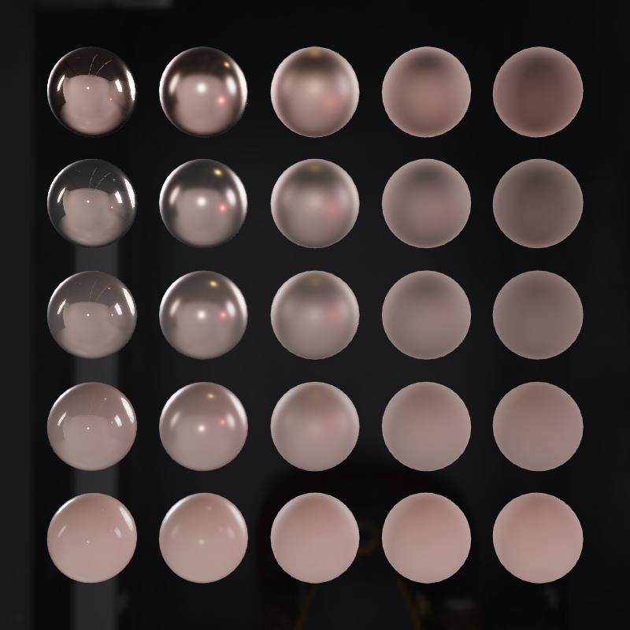
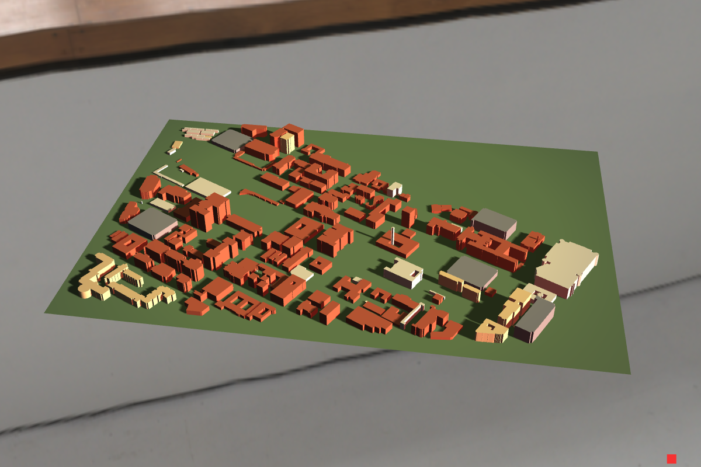

# 3D Rendering Engine (C++ / OpenGL)

A real-time renderer in C++17 and OpenGL 3.3/4.1 core with GLSL shaders. It started
as a 2023 graphics course project (custom OBJ/MTL loading, Phong lighting, skybox)
and was rebuilt in 2026: it now builds on macOS and Linux, has physically based
shading with image-based lighting, shadow mapping, a glTF 2.0 loader, a frame-time
profiler, unit tests, fuzzing and CI.



| | |
|---|---|
|  |  |
| Lantern (glTF, CC0) lit by a Poly Haven HDRI | USC campus extruded from OpenStreetMap, shadow-mapped |

## Features

**Rendering**
- Forward renderer with per-mesh VAOs, interleaved VBOs and per-material index buffers
- Two shading paths:
  - Phong: directional, point and spot lights with distance attenuation and a smooth spot cone
  - PBR, metallic-roughness: Cook-Torrance (GGX, Smith-Schlick, Schlick Fresnel)
- Image-based lighting from an HDR environment, precomputed at start-up in fragment shaders:
  environment cubemap → diffuse irradiance → pre-filtered specular mips (GGX importance sampling) → BRDF LUT
- Environment reflections on Phong materials (MTL `illum` 3–7) with a Fresnel term
- Directional shadow mapping: fitted orthographic light frustum, hardware depth compare,
  1 / 3×3 / 5×5 PCF, slope-scaled and normal-offset bias
- glTF material maps: base colour, metallic-roughness, tangent-space normal, occlusion, emissive
- ACES tone mapping and sRGB output in the PBR path

**Asset loading**
- Hand-written OBJ/MTL parser (no model-loading library): all face index forms,
  negative indices, n-gons, comments and CRLF, vertex de-duplication, normal
  generation, MTL `Pm`/`Pr` PBR keys. Never throws on bad input; bad faces are counted and skipped
- glTF 2.0 (`.gltf` / `.glb`) via [cgltf](https://github.com/jkuhlmann/cgltf): node
  hierarchies baked into vertices, generated tangents when missing, embedded or external images
- `tools/osm2obj.py`: OpenStreetMap buildings → extruded OBJ (ear-clipped roofs,
  courtyards), used for the USC campus scene

**Measurement and testing**
- Frame profiler: CPU timers, GPU timer queries, and a synchronous mode
  (`glFinish` around each pass) for trustworthy per-pass numbers on tile-based GPUs
- `--bench` mode: fixed camera path, vsync off, CSV per frame, mean / median / p95
- Unit tests (doctest + Python), fuzz targets for both loaders (libFuzzer entry
  points plus a built-in mutation driver), AddressSanitizer / UBSan builds
- Every GL object is released at exit; `--capture` reports live buffers, textures,
  VAOs, programs and framebuffers, and the CI render tests require all of them to be 0
- GitHub Actions: Ubuntu (build, tests, renders on Mesa llvmpipe, sanitizer fuzzing)
  and macOS (build, tests)

## Measured results

Apple M4 Pro, macOS 26.6.2, OpenGL 4.1 (Metal), vsync off, Release build.
Medians of 3 runs × 1000 frames; raw logs and CSVs in [`docs/bench/`](docs/bench).
How each number was measured, and what went wrong along the way:
[`docs/ENGINEERING_NOTES.md`](docs/ENGINEERING_NOTES.md).

| What | Result |
|---|---|
| OBJ vertex de-duplication (Rose, 166,844 triangles) | 333,536 → 98,054 vertices (−70.6 %), VBO 10.67 → 3.14 MB |
| OBJ parse time, new vs original parser (Rose) | 108.4 → 56.3 ms |
| IBL precompute from a 2K HDR (5 runs) | 121.3 ms median |
| Shadow pass, 2048² map (USC campus, 9,684 tris / Sports Car, 300,603 tris) | 0.21 ms / 0.83 ms ¹ |
| PCF cost in the main pass, 1 / 9 / 25 taps (campus, 1200×800) | +0.000 / +0.029 / +0.103 ms ¹ |
| glTF fuzzing, structure-aware mode, 60 s under ASan + UBSan | 2.4 M inputs, 11.5 % fully loaded, no findings |
| OBJ fuzzing, 90 s under ASan + UBSan | 710,694 inputs, no findings |

¹ Synchronous timing: each pass is bracketed by `glFinish`, which adds a fixed
≈0.13–0.20 ms per pass; differences between configurations cancel it out.
The scenes here are light, so whole frames take well under 1 ms of CPU time.

## Build

Requires CMake ≥ 3.20, a C++17 compiler and GLM. GLFW (3.5.1), stb_image, cgltf
and doctest are fetched by CMake at pinned versions with SHA-256 checks.

```bash
# macOS
brew install cmake glm
# Ubuntu 24.04
sudo apt install build-essential cmake libglm-dev libglew-dev libglfw3-dev

cmake -S . -B build -DCMAKE_BUILD_TYPE=Release
cmake --build build -j
ctest --test-dir build              # unit tests + short fuzz runs
./tools/fetch_assets.sh             # optional: third-party models and HDRIs (61 MB, hash-checked)
```

Windows: the CMake/GLEW path is written but not tested yet.

## Run

```bash
./build/engine                                                    # Rose, Phong, sphere skybox
./build/engine --model assets/third_party/gltf/Lantern.glb \
               --env assets/third_party/hdri/venice_sunset_2k.hdr --exposure 0.6
./build/engine --model assets/generated/sphere_grid.obj --shading pbr \
               --rotate 0 --camera 0,0,3.3 --exposure 0.35
./build/engine --model assets/third_party/usc_campus/usc_campus.obj --rotate 0 \
               --camera 0.3,1.5,2.1 --target 0,0,0.1 --light-dir -1,-0.55,-0.45 \
               --light-color 1.6,1.5,1.3 --shadows on
./build/engine --model assets/Rose/Rose.obj --bench 1000 --csv rose.csv   # benchmark
```

| Option | Meaning |
|---|---|
| `--model <file>` | `.obj` (MTL next to it) or `.gltf` / `.glb` (implies PBR) |
| `--shading phong\|pbr`, `--env <file.hdr>`, `--exposure k` | shading path; HDR environment and exposure for PBR |
| `--shadows on`, `--shadow-size N`, `--pcf 1\|3\|5` | directional shadow map |
| `--reflect k`, `--skybox <image>` | Phong environment reflection strength; sky panorama |
| `--metallic m`, `--roughness r` | override PBR material values |
| `--camera x,y,z`, `--target x,y,z`, `--rotate deg`, `--size WxH` | view |
| `--light-dir x,y,z`, `--light-color r,g,b` | directional light |
| `--bench N`, `--warmup N`, `--csv file`, `--sync-timing on`, `--vsync on\|off` | benchmarking |
| `--capture file.ppm` | render 10 frames, save one, report live GL objects, exit |
| `--dedup off` | keep one vertex per OBJ face corner (for comparison) |

**Controls:** F1 / F2 / F3 points / wireframe / fill · arrow keys move the point light ·
W A S D move the spot light · Esc quits.

## Project layout

```
src/        engine (main loop, shaders, meshes, IBL, shadows, profiler) and the GL-free loaders
shaders/    GLSL (Phong, PBR, IBL precompute passes, skyboxes, shadow depth)
tests/      doctest suites, fuzz targets and seed corpora
tools/      osm2obj, asset fetch script, benchmark summary, test-scene generators
ci/         Linux build/test/render script used by GitHub Actions
docs/       engineering notes, benchmark data, screenshots
```

## Assets and credits

- Skybox panoramas and HDRIs: [Poly Haven](https://polyhaven.com) (CC0)
- Mori Knob © Yasutoshi Mori, Sports Car © 2015 Yasutoshi Mori, Cornell Box © 2009
  Morgan McGuire et al. — via the [McGuire Computer Graphics Archive](https://casual-effects.com/data) (CC BY)
- SciFiHelmet, Lantern, NormalTangentMirrorTest and DamagedHelmet:
  [Khronos glTF Sample Assets](https://github.com/KhronosGroup/glTF-Sample-Assets) (CC0 / CC-BY 4.0)
- USC campus buildings: © OpenStreetMap contributors, [ODbL 1.0](https://www.openstreetmap.org/copyright)
- Full list with sizes and hashes: [`assets/third_party/SOURCES.md`](assets/third_party/SOURCES.md).
  The Rose model is from the original course materials; its source is unknown.

Libraries: GLFW (zlib), GLEW (BSD/MIT), GLM (MIT), stb_image (MIT / public domain),
cgltf (MIT), doctest (MIT).
